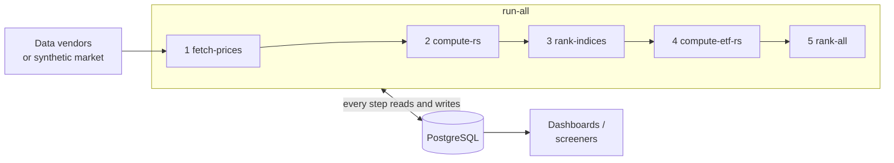

# rs-pipeline

[](https://github.com/scottmcghee/rs-pipeline/actions/workflows/ci.yml)


A daily batch pipeline that ranks stocks by **relative strength (RS)**: how
each stock has performed against the ETFs it belongs to (the ETFs that hold it,
plus its sector and industry ETFs). It ranks every stock within each of those
ETFs, and across all stocks. Momentum investors screen for stocks that are
beating their sector and the market; this pipeline keeps those rankings
current for thousands of stocks, every day.

It downloads daily prices, computes trailing momentum metrics for every
(stock, ETF) pair, and stores percentile rankings in PostgreSQL, where
dashboards and screeners can read them. It runs unattended from cron.

*Python 3.12, pandas and NumPy, PostgreSQL, Docker. Unit tests, plus
integration tests against a real PostgreSQL.*

## Design highlights

- **Incremental runs give exactly the same numbers as a full rebuild.** Each
  metric depends on a bounded window of past prices
  ([invariant 1](docs/DESIGN.md#invariants)), so a daily run loads only that
  window. The tests compare repeated incremental runs with a full recompute,
  bit for bit, including across trading halts.
- **No look-ahead.** No stored value depends on prices after its own date.
- **Ranking can't fall behind, and stays cheap.** A metric row whose RS
  changes loses its rank. The ranking steps then redo only the dates that have
  such rows, so backfills and new stocks are picked up automatically, and a
  normal day re-ranks one date.
- **Split- and dividend-safe.** Vendors rewrite a stock's past prices after a
  split or dividend (a *restatement*). The next run notices, re-downloads that
  history, and rebuilds the series derived from it.
- **Safe to re-run.** Writes are upserts or keyed replacements, every step
  skips work it has already done, and a lock stops two runs from overlapping.
- **Runs offline.** A synthetic market implements the same interfaces as the
  live data vendors, so the demo and the tests exercise the real code paths.

## Try it in one command

You need Docker. The demo runs offline against a fictional, reproducible
market, so no API keys are needed:

```bash
git clone https://github.com/scottmcghee/rs-pipeline.git && cd rs-pipeline
docker compose up --build
```

It sets up 40 fictional companies (their generated tickers sometimes coincide
with real symbols) with sector, industry and thematic ETFs, runs
all five steps over the history since January 2022, and prints the leaders:

```text
Top 15 by overall RS percentile on 2026-10-16:

ticker      company_name  sector relative_strength percentile               etfs
  MIPA    Mipave Systems    Fuel            165.40      100.0           ENGX,MKT
  RORE   Rorezu Partners    Fuel            136.68       97.4      ENGX,MKT,ROBX
  TOMI    Tomini Systems  Health            135.96       94.9           HLTX,MKT
  ...
```

Prices for a given date never change, but the run ends at the latest
completed trading session, so your dates and leaders will differ.
Afterwards:

```bash
docker compose run --rm pipeline top -n 10    # any rs-pipeline command
psql -h localhost -p 54320 -U postgres stocks # password: demo (DEMO_DB_PORT changes the port)
docker compose down -v                        # remove the containers and database
```

## How it works



| Step | What it does |
|---|---|
| `fetch-prices` | Downloads new daily bars, repairs restated history, retires stocks that stop returning data, and fills in each new stock's sector and industry, which links it to the matching ETFs. |
| `compute-rs` | For each (stock, ETF) pair: one-year momentum relative to the ETF, weighted toward recent quarters, plus trailing deviation, percentile and z-score statistics. |
| `rank-indices` | Percentile of each stock's RS among all members of the same ETF, on each date. |
| `compute-etf-rs` | The same metrics for each ETF against a broad-market benchmark, then ranks the ETFs. |
| `rank-all` | Percentile of each stock among *all* stocks on each date, averaging its RS across its ETFs. |

**Terminology.** In command and column names, *index* means an ETF (for example
`--indices` and `rs_rank_index`). The *benchmark* is the one broad-market ETF
that every ETF is compared with (`RS_REF_TICKER`, default SPY). See
[docs/DESIGN.md](docs/DESIGN.md) for exact definitions.

## Running against live data

You need PostgreSQL with a database for the pipeline (it creates its own
tables), and a list of holdings for each ETF you want to track.

```bash
createdb stocks
uv sync                         # Python 3.12+; add --extra twelvedata for the fallback vendor
cp .env.example .env            # set DB_* and HOLDINGS_CSV_DIR=examples/holdings
set -a; . ./.env; set +a

uv run rs-pipeline map-sectors examples/sector_etfs.csv  # sector/industry names -> ETFs
uv run rs-pipeline fetch-prices --indices XLK            # onboard XLK, download its stocks' history
uv run rs-pipeline run-all                               # first full run: prices, metrics, ranks
uv run rs-pipeline top -n 25
```

The first `run-all` fetches the sector ETFs the onboarded stocks were linked
to, and computes everything from `RS_HISTORY_START`. After that, run it daily
once the market has closed: bars count as final from 17:00 New York time, and
earlier runs stop at the previous session. For example, on a server set to
New York time (cron uses the server's time zone):

```cron
30 18 * * 1-5  cd /srv/rs-pipeline && set -a && . ./.env && .venv/bin/rs-pipeline run-all >> rs.log 2>&1
```

- **Holdings** come from `HOLDINGS_CSV_DIR` (one `<etf>.csv` per ETF, with a
  `ticker` column) or from AlphaVantage when `AV_API_KEY` is set. See
  [examples/](examples/).
- **Prices and metadata** come from Yahoo Finance, which needs no key.
  Twelve Data is a fallback price source when `TWELVE_DATA_API_KEY` is set and
  the extra is installed.

### Commands

| Command | Purpose |
|---|---|
| `fetch-prices`, `compute-rs`, `rank-indices`, `compute-etf-rs`, `rank-all` | Run one step |
| `run-all` | Run all five steps in order. If a step fails, the rest still run, and the exit code is 1. |
| `top [-n N] [--on DATE]` | Print the highest-ranked stocks |
| `map-sectors FILE` | Replace the sector/industry → ETF map from a CSV |
| `demo` | Offline demo: set up the fictional market, run everything, print the leaders |
| `seed-demo` | Only set up the fictional market |

`demo` and `seed-demo` always use the synthetic market. They refuse to run
against a database that already holds other data, so point `DB_NAME` at an
empty database.

### Options

| Option | Applies to | Meaning |
|---|---|---|
| `--end-date D` | steps, `run-all` | Last date to process (default: today). Bars are stored only for completed sessions. |
| `--start-date D` | steps, `run-all` | Reprocess from `D`: re-download, recompute and re-rank from `D` on. Without it, only new data is processed. |
| `--indices A,B` | `fetch-prices`, `compute-rs`, `rank-indices`, `compute-etf-rs`, `run-all` | Only these ETFs. `fetch-prices` onboards ones it doesn't know yet. |
| `--full-recompute` | compute steps, `run-all` | Recompute every metric from all stored prices; in `run-all`, also re-rank every date. Changing `--window` needs this, without `--indices`. |
| `--window N` | compute steps, `run-all` | Rolling window for the statistics, in trading days (default 252) |
| `--max-workers N` | `compute-rs`, `run-all` | ETFs computed in parallel (default: CPU count, up to 8) |
| `--source live\|synthetic` | all except `demo`, `seed-demo` | Where data comes from (env `RS_SOURCE`) |
| `--log-level LEVEL` | all | `DEBUG`, `INFO` (default), `WARNING` or `ERROR` |

Underscore spellings (`--start_date`, `--end_date`, `--max_workers`, ...) are
accepted as aliases.

### Configuration

All configuration comes from environment variables; see [.env.example](.env.example).

| Variable | Default | Purpose |
|---|---|---|
| `DB_HOST`, `DB_PORT`, `DB_NAME`, `DB_USER`, `DB_PASSWORD` | `localhost`, `5432`, `stocks`, `postgres`, empty | PostgreSQL connection |
| `RS_SOURCE` | `live` | `live` or `synthetic` |
| `RS_REF_TICKER` | `SPY` | The benchmark: the ETF every other ETF is measured against |
| `RS_BENCHMARK_TICKERS` | `SPY,QQQ,IWM` | Broad-market ETFs that get no ETF-vs-benchmark metrics or ETF rank (`RS_REF_TICKER` always counts as one). Stocks are still ranked within them. |
| `RS_HISTORY_START` | `2020-01-01` | First date fetched for a newly added ticker |
| `HOLDINGS_CSV_DIR`, `AV_API_KEY` | empty | Where ETF holdings come from |
| `TWELVE_DATA_API_KEY` | empty | Optional fallback price vendor |

## Development

```bash
uv sync && uv run pre-commit install
uv run pytest                          # everything; integration tests need Docker
```

See [CONTRIBUTING.md](CONTRIBUTING.md) for the individual checks. CI runs
lint, strict type checks, the tests on Python 3.12 and 3.13 with a 90%
coverage floor, a secret scan, and the Docker demo.

## Documentation

- [docs/ARCHITECTURE.md](docs/ARCHITECTURE.md): modules, data flow, schema
- [docs/DESIGN.md](docs/DESIGN.md): metric definitions, invariants, design decisions
- [docs/REQUIREMENTS.md](docs/REQUIREMENTS.md): functional and nonfunctional requirements, each linked to its tests

## Limitations

- **Holdings are fixed at onboarding.** An ETF's holdings are read once, when
  it is first onboarded, and are not refreshed. A stock's sector and industry
  are also looked up once. History is computed for those constituents only
  (survivorship bias), which is fine for screening but not for backtesting.
- **Small dividends go unnoticed.** A restatement smaller than 0.05% (a very
  low-yield quarterly dividend) is below the detection threshold. Its effect on
  RS is equally small.
- **One adjustment basis per ticker.** Restatement detection assumes a ticker's
  prices come from one vendor. If a ticker alternates between Yahoo and the
  fallback vendor, their different adjustments look like restatements and
  cause extra history re-downloads.
- **Data quality** is whatever the vendors return. Gaps are tolerated (metrics
  use the dates a stock and its ETF share), but bad prints are not detected.

## License

[MIT](LICENSE)
