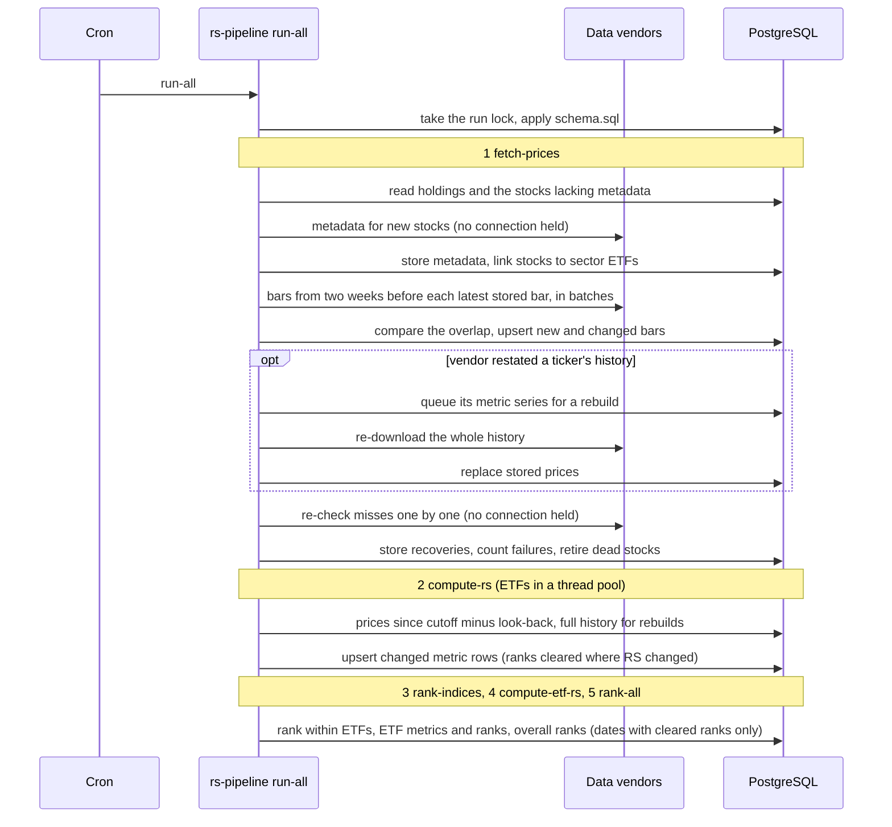
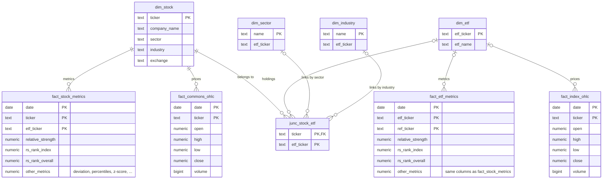

# Architecture

## Modules

```text
src/rs_pipeline/
├── cli.py            argparse commands; builds the Context and runs steps
├── config.py         Settings from environment variables; tuning constants
├── pipeline.py       Context and RunOptions passed to every step; look-back, session and window checks
├── rs.py             the metrics (pure pandas/NumPy, no I/O)
├── db.py             connection pool, run lock, schema, every SQL statement
├── schema.sql        all tables and indexes (idempotent; applied on every run)
├── universe.py       onboarding ETFs; stock metadata and sector linking
├── retry.py          exponential backoff for rate-limited vendors
├── sources/
│   ├── base.py       PriceSource / InfoSource / HoldingsSource protocols, normalization
│   ├── __init__.py   build_sources("live" | "synthetic"); FallbackPrices
│   ├── yahoo.py      yfinance prices and metadata
│   ├── twelvedata.py Twelve Data price fallback (optional extra)
│   ├── holdings.py   CSV and AlphaVantage holdings
│   └── synthetic.py  fictional reproducible market for the demo and tests
└── steps/
    ├── fetch_prices.py    1. download, restatement detection and repair, re-check, failures
    ├── compute_rs.py      2. stock-vs-ETF metrics, parallel by ETF
    ├── rank_indices.py    3. rank within each ETF
    ├── compute_etf_rs.py  4. ETF-vs-benchmark metrics and ETF ranks
    ├── rank_all.py        5. rank across all stocks
    └── _incremental.py    cutoffs, look-back, history checks and rebuilds shared by steps 2 and 4
```

Imports only point downward: `cli` → `steps` → `pipeline` → `db`, `rs`, `sources`;
`cli` and `fetch-prices` also use `universe`. Nothing imports `cli` or `steps`.
`rs.py` and `sources/base.py` import nothing from the rest of the package. Steps
receive everything they need in a `Context` (settings, sources, pool,
options) instead of reading globals. That is what lets the tests swap in the
synthetic market, or a deliberately broken vendor.

## A daily run



## Schema



`junc_stock_etf.etf_ticker` points at an onboarded ETF in `dim_etf`, or at the
ETF named by `dim_sector` / `dim_industry`. Sector and industry ETFs (and a
benchmark that isn't onboarded) have prices and metrics but no `dim_etf` row.
The relationships in the diagram are logical: only `junc_stock_etf.ticker` is a
declared foreign key.

Bookkeeping tables support the invariants in [DESIGN.md](DESIGN.md):
- `ticker_fetch_failures` and `delisted_tickers` for delisting (invariant 7);
- `metrics_rebuild` for queued restatement rebuilds (invariant 8);
- `pipeline_state` for the rolling window the stored metrics use.

The full DDL is in [`src/rs_pipeline/schema.sql`](../src/rs_pipeline/schema.sql),
plain PostgreSQL, tested on 18.

## Testing

| Layer | Where | Needs | What it shows |
|---|---|---|---|
| Unit | `tests/unit` | nothing | Metric math and its exact trailing bound, download planning, restatement detection, cutoffs and history checks, sessions, vendor clients (mocked), synthetic market, settings, CLI parsing |
| Integration | `tests/integration` | Docker | Real SQL on PostgreSQL 18: rankings, upserts, the rebuild queue, connection handling and the run lock, failures and delisting, restatement repair, the CLI, and whole-pipeline invariants (incremental = full, idempotence) |
| Demo | `docker compose up` | Docker | A clean checkout builds, seeds, runs and reports |

All three run in CI. Each integration test gets its own database, cloned from
a template (an empty schema, or the demo already run to a fixed date), so the
expensive setup runs once per session.
